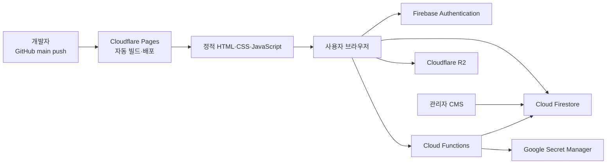

# Grit Edu LMS/CMS

> 학원 홍보 사이트, 온라인 강의, 오프라인 수업, 회원·강사 관리, 관리자 CMS를 하나로 통합한 교육 운영 웹 서비스입니다.

[](https://gritedu.kr)


## 프로젝트 개요

Grit Edu LMS/CMS는 그릿에듀학원의 공개 웹사이트와 학원 운영 시스템을 통합한 프로젝트입니다.

공개 방문자는 강의, 강사, 시간표, 학원 소개와 상담 정보를 확인할 수 있습니다. 학생·회원·학부모·강사는 각 역할에 맞는 전용 화면을 이용하며, 관리자는 CMS에서 계정, 강의, 오프라인 반, 시간표, 사이트 콘텐츠와 팝업을 관리할 수 있습니다.

| 항목 | 내용 |
| --- | --- |
| 프로젝트명 | Grit Edu LMS/CMS |
| 제작 기간 | 2026.05 ~ 2026.07 |
| 서비스 유형 | 학원 웹사이트 + LMS + 관리자 CMS |
| 운영 상태 | 1차 개발 완료 및 운영 |
| 운영 사이트 | [https://gritedu.kr](https://gritedu.kr) |
| 주요 목표 | 낮은 운영비로 학원 운영에 필요한 핵심 기능 통합 |

## 개발 배경

학원 운영에는 다음과 같은 업무가 동시에 필요합니다.

- 학원 홍보용 공개 웹사이트 운영
- 학생·회원·학부모·강사 계정 관리
- 온라인 강의와 수강 정보 관리
- 오프라인 반, 학생 배정과 회차 관리
- 공개 시간표와 팝업 공지 관리
- 사이트 콘텐츠와 운영 데이터 관리

여러 서비스를 따로 사용하면 데이터가 분산되고 같은 정보를 반복해서 입력해야 합니다. 이 프로젝트는 정적 웹과 서버리스 구조를 활용해 필요한 기능을 하나의 시스템으로 통합하는 것을 목표로 제작했습니다.

## 주요 기능

### 1. 공개 웹사이트

- 메인 페이지
- 온라인 강의 목록과 상세 정보
- 강사진 목록과 상세 프로필
- 공개 수업 시간표
- 학원 소개
- 상담 문의와 오시는 길
- 팝업 공지
- 반응형 모바일 UI와 다크 모드
- 카카오톡 채널 연결
- PWA 설치 지원
- 검색엔진 최적화
  - Canonical URL
  - Open Graph
  - JSON-LD
  - Sitemap
  - Robots.txt

### 2. 회원가입과 인증

- Firebase Authentication 기반 이메일·비밀번호 로그인
- 이메일 인증번호 발송과 검증
- 학생, 일반 회원, 학부모, 강사, 관리자 역할 분리
- 회원가입 단계별 입력과 검증
- 학교 검색 데이터 제공
- 이용약관과 개인정보 처리방침 동의 관리
- 인증 요청 횟수 제한과 만료 기록 정리

### 3. 온라인 강의 LMS

- 강의 목록과 상세 페이지
- 공개 강의와 회원 전용 강의 구분
- 강의 공개, 초안, 보관 상태 관리
- 학생·회원별 수강 연결
- 강사별 담당 강의 조회
- 커리큘럼과 주차별 학습 콘텐츠 관리
- 학습 진도와 수강 상태 관리

### 4. 오프라인 수업 관리

- 오프라인 반 생성·수정·보관
- 담당 강사 연결
- 학생 배정과 해제
- 수업 회차 생성·수정·삭제
- 학생별 회차 접근 상태 관리
- 강사별 담당 반과 수강생 조회
- 공개 시간표 항목과 노출 순서 관리

### 5. 역할별 전용 화면

| 역할 | 주요 기능 |
| --- | --- |
| 공개 방문자 | 강의, 강사, 시간표, 학원 소개와 상담 정보 조회 |
| 학생 | 본인 온라인 강의, 오프라인 반, 회차와 학습 정보 확인 |
| 일반 회원 | 본인 수강 강의와 회원 정보 관리 |
| 학부모 회원 | 자녀 계정 연결과 자녀 학습 정보 확인 |
| 강사 | 담당 온라인 강의, 오프라인 반과 수강생 조회 |
| 관리자 | 계정, 강의, 반, 시간표, 콘텐츠와 운영 데이터 통합 관리 |

### 6. 관리자 CMS

- 관리자 대시보드
- 학생·회원·강사·관리자 계정 관리
- 강사 공개 프로필과 이미지 관리
- 온라인 강의 관리
- 수강생 연결 관리
- 오프라인 반과 수업 회차 관리
- 공개 시간표 관리
- 학원 소개와 상담 페이지 관리
- 팝업 공지 관리
- 메뉴, 카탈로그와 회원가입 설정 관리
- 만료된 인증·가입·자녀 연결 기록 정리

### 7. 운영 자동화

- GitHub `main` 브랜치 push 기반 자동 배포
- 빌드 시 CSS·JavaScript 최적화
- 이미지 WebP 변환과 참조 경로 검증
- 빌드 버전 생성과 새 버전 안내
- Cloudflare Pages 캐시 헤더 생성
- 이메일 인증·가입 시도·자녀 연동 시도 중 `cleanupAt`이 지난 allowlist 문서를 매일 03:00(Asia/Seoul) bounded query로 자동 정리
- 공개 운영 이미지를 Cloudflare R2에서 교체 가능

## 작동 원리



### 처리 흐름

1. Cloudflare Pages가 빌드된 정적 웹 파일을 사용자에게 제공합니다.
2. Firebase Authentication이 로그인과 사용자 인증을 처리합니다.
3. 역할별 Firestore 문서와 Security Rules가 접근 권한을 판단합니다.
4. Cloud Firestore가 강의, 회원, 반, 시간표와 CMS 데이터를 저장합니다.
5. Cloud Functions가 이메일 인증, 자녀 연결과 만료 기록 정리를 처리합니다.
6. Cloudflare R2가 팝업, 강사, 학원 소개 등 자주 변경되는 공개 이미지를 제공합니다.
7. CMS 데이터 변경은 Firestore를 통해 즉시 반영되며, 코드나 로컬 파일 변경은 다시 빌드·배포합니다.

## 기술 스택

| 구분 | 기술 |
| --- | --- |
| Frontend | HTML5, CSS3, Vanilla JavaScript, ES Modules |
| UI | Responsive Web, Dark Mode, PWA |
| Authentication | Firebase Authentication |
| Database | Cloud Firestore |
| Server Logic | Cloud Functions for Firebase |
| Security | Firestore Security Rules, Google Secret Manager |
| Email | Nodemailer |
| Hosting | Cloudflare Pages |
| Public Assets | Cloudflare R2, Local `/assets` |
| Build | Node.js, Sharp, PostCSS, cssnano, Terser |
| Version Control | Git, GitHub |
| SEO | Sitemap, Robots.txt, Open Graph, JSON-LD |

## 프로젝트 구조

```text
gritedu.github.io/
├─ assets/
│  ├─ css/                 # 공통·컴포넌트·페이지 스타일
│  ├─ js/                  # 공통 모듈, 기능별·페이지별 스크립트
│  ├─ partials/            # 공통 헤더와 푸터
│  ├─ icons/               # PWA와 앱 아이콘
│  ├─ instructors/         # 로컬 강사 이미지
│  ├─ popup/               # 로컬 팝업 이미지
│  └─ school.csv           # 학교 검색 데이터
├─ members/
│  ├─ admin/               # 관리자 CMS
│  ├─ students/            # 학생 전용 화면
│  ├─ member/              # 일반·학부모 회원 화면
│  └─ instructors/         # 강사 전용 화면
├─ functions/              # Firebase Cloud Functions
├─ scripts/                # 빌드·검증·정리 스크립트
├─ docs/                   # 운영·설계·감사 문서
├─ md/                     # 데이터베이스 문서
├─ manifest.webmanifest    # PWA 설정
├─ firestore.rules         # Firestore 접근 권한
├─ firebase.json           # Firebase와 로컬 실행 설정
├─ package.json
└─ README.md
```

`dist/`는 `npm run prebuild` 또는 `npm run build` 실행 시 다시 생성되는 배포 산출물이므로 Git에서 관리하지 않습니다. 로컬에서는 미리보기용으로 만들고, 운영 배포 시에는 Cloudflare Pages가 같은 산출물을 새로 빌드합니다.

## 설치 및 로컬 실행

### 요구 환경

- Node.js 22 권장
  - 루트 프로젝트 최소 요구 버전: Node.js 18.17 이상
  - Firebase Functions 요구 버전: Node.js 22
- npm
- Firebase CLI
- Firebase 프로젝트 접근 권한

### 1. 저장소 복제

```bash
git clone https://github.com/gritedu/gritedu.github.io.git
cd gritedu.github.io
```

### 2. 의존성 설치

```bash
npm ci
npm --prefix functions ci
```

### 3. Firebase 로그인

Firebase 프로젝트 기능과 에뮬레이터를 사용할 경우 로그인합니다.

```bash
npx firebase login
```

### 4. 빌드와 로컬 미리보기

```bash
npm run preview
```

기본 로컬 주소:

```text
http://localhost:5000
```

빌드와 실행을 분리하려면 다음 명령을 사용합니다.

```bash
npm run build
npm run verify
npm run serve
```

`npm run build`를 실행하면 npm lifecycle에 의해 `prebuild`가 먼저 자동 실행됩니다. `build` 단계에서는 생성된 `dist/`만 확인하므로 실제 빌드는 한 번만 수행됩니다. 실제 빌드 스크립트만 직접 실행하려면 `npm run prebuild`를 사용합니다.

> 로컬 화면도 운영 Firestore에 연결될 수 있습니다. 화면 확인 목적의 테스트만 수행하고, 실제 운영 데이터는 배포된 관리자 CMS에서 수정하는 것을 원칙으로 합니다.

## 주요 명령어

| 명령어 | 설명 |
| --- | --- |
| `npm run prebuild` | `dist/` 빌드 산출물 생성 |
| `npm run build` | `prebuild`를 자동으로 한 번 실행하고 `dist/` 생성 여부 확인 |
| `npm run prebuild:strict` | 엄격한 기준으로 빌드 |
| `npm run build:strict` | `prebuild:strict`를 자동으로 한 번 실행하고 `dist/` 생성 여부 확인 |
| `npm run verify` | 빌드 파일과 필수 산출물 검증 |
| `npm run verify:strict` | 엄격한 기준으로 빌드 결과 검증 |
| `npm run ready:deploy` | 빌드, 검증, Rules와 Functions 상태 통합 점검 |
| `npm run lint` | 프런트엔드 ESLint 검사(오류는 실패, 기존 정리 후보는 경고) |
| `npm run lint:fix` | 자동 수정 가능한 ESLint 항목 정리 |
| `npm run preview` | 빌드 후 로컬 서버 실행 |
| `npm run serve` | 기존 `dist/`를 로컬에서 실행 |
| `npm run convert-webp` | 지정 이미지 WebP 변환 |
| `npm run check:rules` | Firestore Rules 준비 상태 확인 |
| `npm run check:functions` | Functions 준비 상태 확인 |
| `npm run deploy:rules` | Firebase 프로젝트 `gritedu-lms`에 Firestore Rules만 배포 |
| `npm run deploy:functions` | Firebase 프로젝트 `gritedu-lms`에 Functions 전체 배포 |

전체 명령 흐름과 변경 유형별 배포 범위는 [`docs/BUILD_AND_DEPLOY.md`](docs/BUILD_AND_DEPLOY.md)를 참고합니다.

## 빌드 및 배포

### 정적 웹사이트 배포

현재 운영 사이트는 Firebase Hosting이 아니라 Cloudflare Pages로 배포합니다.

```bash
npm run build
npm run verify
git diff --check
git status
git add .
git commit -m "작업 내용"
git push origin main
```

`main` 브랜치에 push되면 Cloudflare Pages가 자동으로 다음 설정을 사용합니다.

| 항목 | 값 |
| --- | --- |
| Production branch | `main` |
| Build command | `npm run prebuild` |
| Output directory | `dist` |
| Node version | `22` |

배포가 완료되면 [https://gritedu.kr](https://gritedu.kr)에서 실제 동작을 확인합니다.

### Firebase 배포

Firestore Rules와 Cloud Functions는 정적 사이트 배포와 별도로 처리합니다.

```bash
npm run check:rules:strict
npm run deploy:rules

npm run check:functions:strict
npm run deploy:functions
```

> Firebase Hosting은 비활성화되어 있습니다. `firebase deploy --only hosting`은 현재 일반 운영 배포에서 사용하지 않습니다.

## 변경 유형별 반영 방식

| 변경 내용 | 재배포 | 처리 방식 |
| --- | --- | --- |
| CMS 문구·설정·시간표 데이터 | 불필요 | CMS 저장 후 Firestore 데이터로 반영 |
| R2 팝업·강사·Story 이미지 | 불필요 | 새 R2 객체 업로드 후 CMS URL 교체 |
| 로컬 `/assets` 이미지·PDF·CSV | 필요 | 파일 추가 후 빌드·검증·Git push |
| HTML·CSS·JavaScript | 필요 | 빌드·검증·Git push |
| Firestore Rules | 별도 필요 | Firebase CLI로 Rules 배포 |
| Cloud Functions | 별도 필요 | Firebase CLI로 Functions 배포 |
| Firebase Auth 계정 | 정적 배포와 무관 | Firebase Console 또는 계정 관리 절차 사용 |

## 이미지와 파일 운영

### 로컬 자산

다음과 같이 장기간 고정되는 파일에 사용합니다.

- 로고와 Favicon
- 공통 아이콘
- 기본 배너
- PWA 아이콘
- 학교 검색 CSV
- 공개 PDF
- 기본 이미지와 fallback 이미지

CMS에는 `/assets/...` 경로를 저장하며, 실제 파일을 저장소 `assets/**`에 추가한 뒤 빌드와 배포가 필요합니다.

### Cloudflare R2

다음과 같이 자주 변경되는 공개 이미지에 사용합니다.

- 팝업 이미지
- 강사 프로필 이미지
- 강사 커리큘럼 이미지
- 학원 소개 배너와 대표 이미지
- 학원정보조회·교습비·환불규정 이미지

운영 기본 도메인:

```text
https://assets.gritedu.kr
```

동일한 파일 key를 덮어쓰지 않고 새 key를 생성한 뒤 CMS의 URL을 교체합니다.

### 비공개 파일

학생별 리포트, 성적표, 과제와 내부 운영 파일은 public R2에 저장하지 않습니다. 향후 비공개 파일 기능은 Private R2, 권한 검증과 Signed URL 방식으로 별도 구현해야 합니다.

## 데이터와 보안 원칙

- Firestore Security Rules를 최종 접근 제어 경계로 사용합니다.
- 역할별 canonical collection을 기준으로 사용자 권한을 판정합니다.
- 관리자 CMS의 화면 제어만 믿지 않고 Rules에서 읽기·쓰기 권한을 제한합니다.
- 이메일 계정 비밀번호 등 민감 정보는 Google Secret Manager에 저장합니다.
- Firebase 설정과 API Key는 서버 비밀값과 구분하며, 실제 Secret은 저장소에 커밋하지 않습니다.
- `courses` 컬렉션은 공개 읽기 영역이므로 다음 정보를 저장하지 않습니다.
  - 비공개 원본 영상 URL
  - DRM 토큰
  - 결제 정보
  - 개인별 접근 권한
  - 내부 운영 메모
- CMS에서 사용자를 삭제해도 Firebase Authentication 계정은 별도로 남을 수 있으므로 Auth 계정까지 함께 확인합니다.
- 학생, 회원, 강사, 강의와 반 삭제 전 연결된 수강·배정 데이터를 먼저 확인합니다.

## 운영 시 주의사항

- 공개 시간표는 오프라인 반 데이터와 자동 실시간 동기화되지 않습니다.
- 오프라인 반 수정 후 공개 시간표 반영 상태를 별도로 확인해야 합니다.
- CMS의 파일 선택 기능은 실제 업로드가 아니라 경로 입력 보조일 수 있습니다.
- 로컬 이미지 경로만 저장하고 실제 파일을 배포하지 않으면 화면에서 이미지가 깨집니다.
- 관리자 삭제와 운영 기록 정리는 되돌리기 어려우므로 대상 데이터를 확인한 뒤 실행합니다.
- `dist/`, `node_modules/`, Firebase 로그와 Secret 파일은 Git에 커밋하지 않습니다.
- 운영 중인 Firebase Hosting은 비활성화되어 있으며, 정적 사이트는 Cloudflare Pages를 기준으로 관리합니다.

## 현재 구현 범위와 한계

### 구현 완료

- 공개 웹사이트
- 역할별 로그인과 대시보드
- 온라인 강의와 수강 연결
- 오프라인 반과 회차 관리
- 공개 시간표
- 관리자 CMS
- 공통 변경 감지·확인 모달과 영구 삭제 확인 문구
- 이메일 인증
- 자녀 계정 연결
- 운영 기록 자동·수동 정리
- 매일 03:00 만료 운영 기록 자동 정리와 오프라인 수업 보존 정책
- Cloudflare Pages 자동 배포
- Cloudflare R2 공개 이미지 운영
- PWA 설치 지원

### 현재 미구현 또는 제한

- 결제와 PG 연동
- 유료 강의 권한 서버
- DRM과 비공개 영상 보호
- 네이티브 Android·iOS 앱
- Push 알림
- CMS 직접 파일 업로드
- 학생별 비공개 자료실과 Signed URL
- 완전한 ERP 회계·출결·문자 기능

## 라이선스

본 프로젝트는 그릿에듀 서비스 운영과 포트폴리오를 위한 프로젝트입니다.

별도의 오픈소스 라이선스가 명시되지 않은 소스와 콘텐츠의 무단 복제, 배포와 상업적 이용을 허용하지 않습니다.
